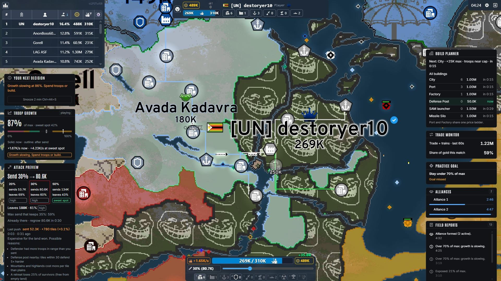
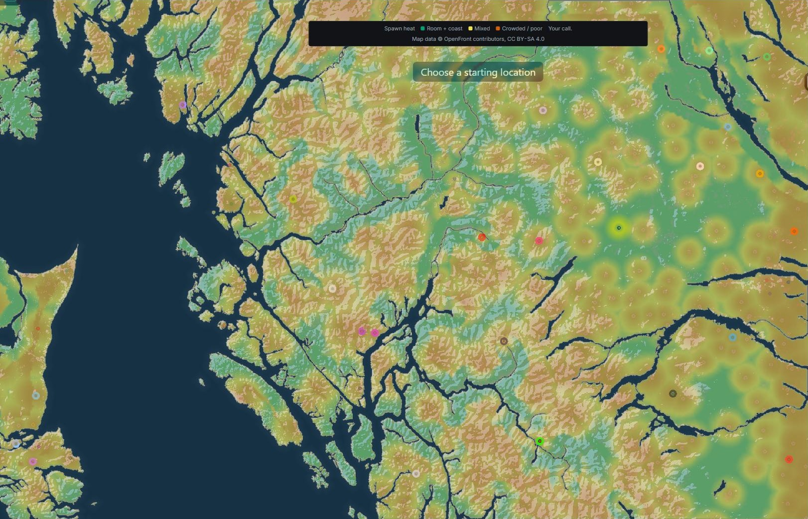
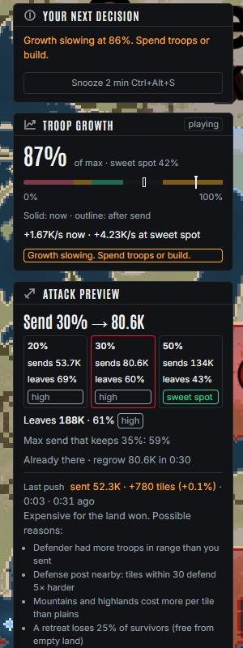
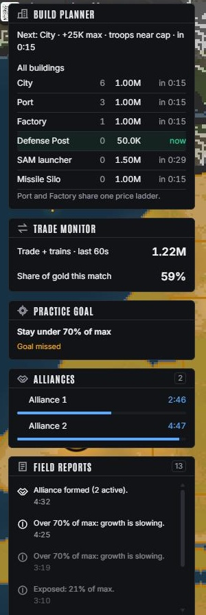

<p align="center"></p>

<h1 align="center">FlashFront</h1>

<p align="center">A fair-play companion for <a href="https://openfront.io">OpenFront</a> on Steam (Windows).<br>Your own numbers beside the map, and a coach after the match.</p>

<p align="center"><a href="../../releases/latest"><b>Download the latest installer</b></a></p>



## What it does

- **Troop growth:** where your growth peaks, and when you're sitting too high.
- **Attack preview:** what a send leaves you with, how long it takes to regrow, and why your last push gained little land.
- **Build planner:** your next build, when you can afford it, and when gold is sitting idle.
- **Alliance timers** and incoming attacks against your own troops.
- **One decision card at a time:** big attack incoming, exposed after a push, city affordable.
- **Spawn heat map:** hold Space during the spawn phase to see open land with coast, away from players who already landed. A notification and chime tell you when spawn starts.
- **Match review:** a synced timeline, bookmarks, a death debrief, personal bests and a share card for Discord.
- **OBS overlay** for streamers.



| Left column | Right column |
|---|---|
|  |  |

## Fair play

- **Read-only.** FlashFront never clicks, sends, builds or attacks for you.
- **Your numbers only**, plus where players land during the spawn phase (which the game already shows everyone).
- **Hidden in ranked** by default.
- **Nothing uploaded unless you send feedback.** Matches stay on your PC.

## Install

1. Download `FlashFront-Setup-<version>.exe` from [Releases](../../releases/latest) and run it.
2. Windows may show "Windows protected your PC" because the installer isn't code-signed yet. Choose **More info**, then **Run anyway**.
3. FlashFront opens a short setup that walks you through adding one Steam launch option for OpenFront.

FlashFront then appears on your desktop and in the Start menu, and from 0.2.0 on it updates itself ("Restart to update"). Uninstall it from Windows Settings, then Apps.

**Requirements:** Windows 10 or 11 and the Steam version of OpenFront. The browser version isn't supported yet.

---

FlashFront is an independent fan project. It is not affiliated with or endorsed by OpenFront. Map data © OpenFront contributors, CC BY-SA 4.0.

## Building from source

Use Node.js 24 and pnpm 11.20.0. From the repository root:

```sh
pnpm install
pnpm test
pnpm --dir apps/launcher dist
```

`pnpm test` runs `pnpm -r test` across the workspace. The launcher `dist` script runs `electron-vite build && electron-builder --win --publish never` and writes the Windows installer to `apps/launcher/release/`.

## License

AGPL-3.0-only. See [LICENSE](LICENSE).

## Credits

See the [map data and derived assets attribution](packages/core/src/spawn/LICENSE-MAPDATA.md) for sources, licensing, and modifications.
